# Directorio: consumo de una API REST con Retrofit

Proyecto individual de **Programación III (UPB)**. Se implementó una app Android que consume la API
[ReqRes](https://reqres.in) con **Retrofit + Gson + Corrutinas**, organizada con **MVVM**, siguiendo el
*Manual: consumir una API con Retrofit*.

**Autora:** Adriana Milenka Torrico Cardoso

## Qué hace la app

| Función | Verbo | Endpoint | Anotaciones |
|---|---|---|---|
| Lista paginada de usuarios con foto | GET | `users?page={n}` | `@GET`, `@Query`, `@Header` |
| Detalle de un usuario | GET | `users/{id}` | `@GET`, `@Path`, `@Header` |
| Crear usuario | POST | `users` | `@POST`, `@Body` |
| Editar usuario | PUT | `users/{id}` | `@PUT`, `@Path`, `@Body` |
| Eliminar usuario | DELETE | `users/{id}` | `@DELETE`, `@Path`, `Response<Unit>` |

> ReqRes es una API de práctica: responde como si creara, editara o borrara, pero **no guarda los cambios**
> (igual que JSONPlaceholder en el manual). Por eso, después de un POST, la lista no cambia.

## Cómo ejecutarlo

1. Crear una cuenta gratis en <https://app.reqres.in> y copiar la API key.
2. En `local.properties` (raíz del proyecto, ignorado por git) agregar:
   ```
   API_KEY=tu-clave-de-reqres
   ```
3. Sync de Gradle → **Build → Rebuild Project** → Run.

> La clave de prueba de ReqRes vence (la usada vence el 2026-12-10). Si la app muestra
> "La API key falta o es incorrecta (código 401 o 403)", hay que generar una clave nueva.

## Arquitectura (MVVM)

```
Pantalla (Compose) --> ViewModel (StateFlow) --> UsuarioRepository --> ReqresApiService (Retrofit) --> ReqRes
   dibuja el estado      guarda el estado         llama a la API,        describe los endpoints
                                                   traduce errores
```

| Capa | Archivos | Responsabilidad |
|---|---|---|
| Fuente de datos | `data/remote/UsuarioDtos.kt` | Forma del JSON (DTO de respuesta y de envío) |
| Fuente de datos | `data/remote/ReqresApiService.kt` | Endpoints con anotaciones de Retrofit |
| Fuente de datos | `data/remote/FabricaRetrofit.kt`, `RetrofitClient.kt` | Instancia única, tiempos de espera, log en debug |
| Repositorio | `data/UsuarioRepository.kt`, `data/Mapeadores.kt` | Llama a la API, convierte DTO → modelo, traduce errores |
| Modelo | `model/Usuario.kt`, `util/Resultado.kt` | Modelo del dominio y resultado éxito/error |
| ViewModel | `ui/list`, `ui/detail`, `ui/form` | Estado de cada pantalla |
| Vista | `*Screen.kt`, `ui/components/MensajeDeError.kt` | Dibuja cargando, error y datos |

## Cobertura del manual

| Etapa | Pasos | Estado |
|---|---|---|
| 1. Instalar Retrofit | 1–3 | ✅ Dependencias, `mavenCentral`, permiso `INTERNET` |
| 2. Entender la API y DTO | 4–5 | ✅ Probada con curl, `@SerializedName` (`first_name`, `total_pages`), DTO ≠ modelo |
| 3. GET en MVVM | 6–10 | ✅ Lista con `@Query` y detalle con `@Path` |
| 4. Enviar datos | 11 | ✅ POST, PUT y DELETE con `@Body` |
| 4. API del curso | 12 | ⚠️ 12b cubierto (respuesta envuelta en `data`). 12a y 12c son propios de la API del curso (SQLite Cloud), cuya clave no se entregó |
| 4. API key segura | 13 | ✅ `local.properties` → `BuildConfig.API_KEY` → `@Header("x-api-key")` |
| 5. Errores y depuración | 14–16 | ✅ `IOException`, `HttpException` (403/404), Logcat con la clave oculta. MockWebServer (opcional) no se implementó |

## Manejo de errores

| Situación | Excepción | Mensaje al usuario |
|---|---|---|
| Sin internet | `IOException` | "No hay conexión a internet…" |
| API key mala | `HttpException` 401/403 | "La API key falta o es incorrecta (código 403)" |
| Usuario inexistente | `HttpException` 404 | "No se encontró ese usuario (código 404)" |
| Salir mientras carga | `CancellationException` | Se vuelve a lanzar; no es un error |

ReqRes responde **403** cuando la API key es incorrecta. El repositorio agrupa 401 y 403 porque ambos
significan "falta autenticación o permiso".

## Capturas

| Lista | Detalle | POST | DELETE |
|---|---|---|---|
| 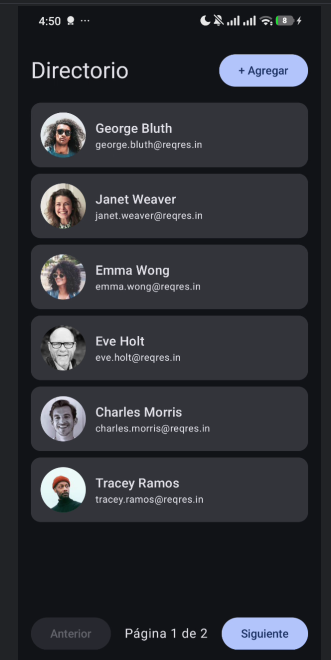 | 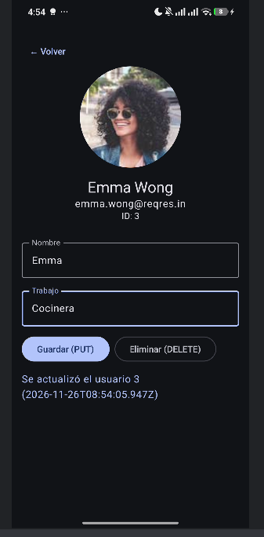 | 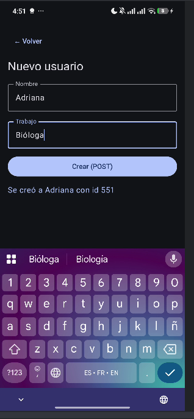 | 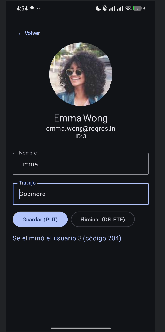 |

| Sin internet | API key mala (403) | Usuario inexistente (404) |
|---|---|---|
| 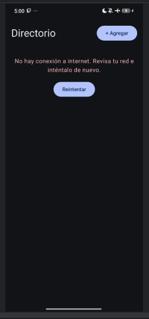 | 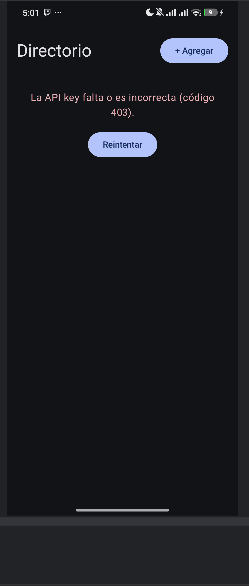 | 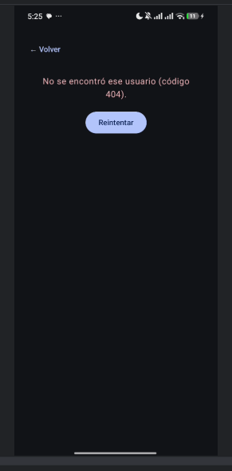 |

| Logcat GET | Logcat POST | Logcat DELETE |
|---|---|---|
| 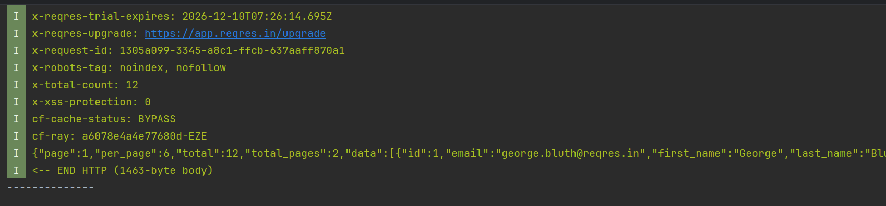 | 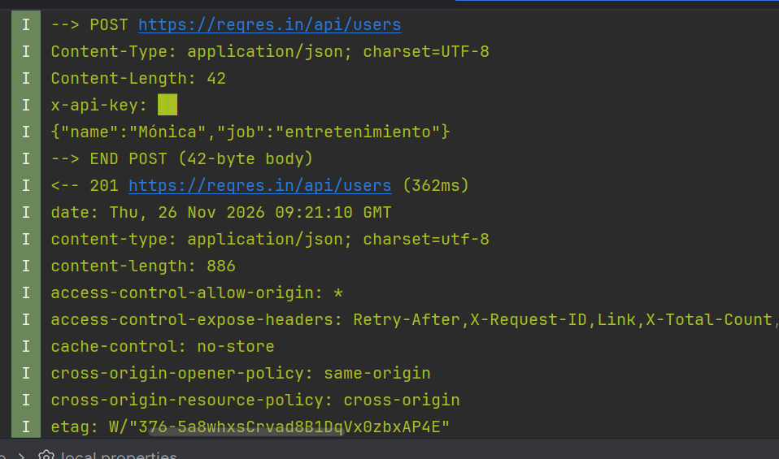 | 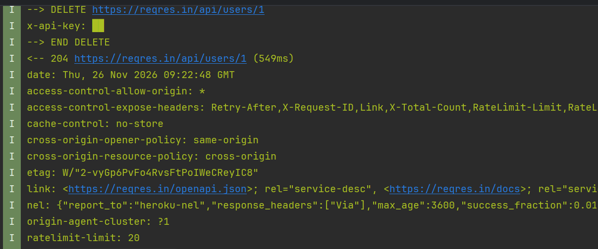 |

| Logcat error 403 (API key mala) |
|---|
| 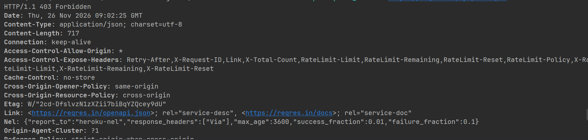 |

| Logcat error 404 (usuario inexistente) |
|---|
| 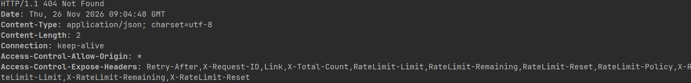 |